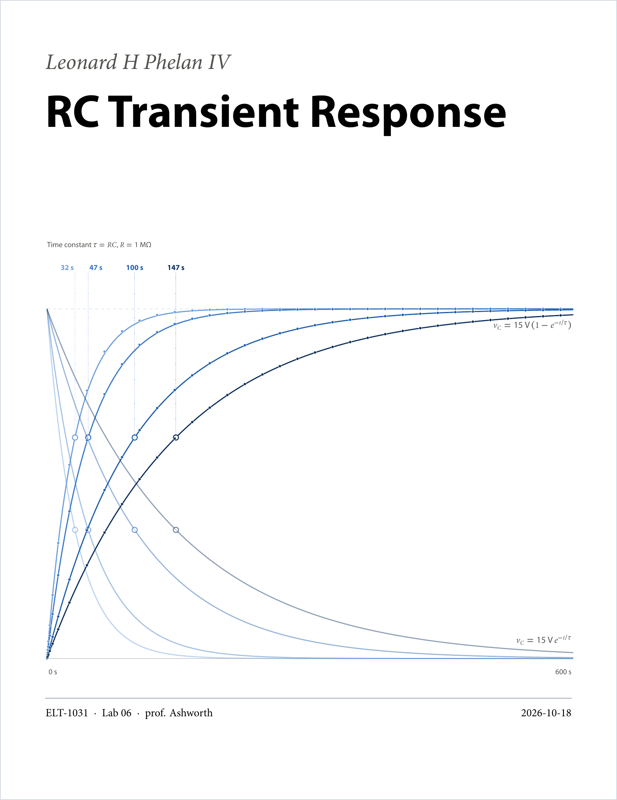
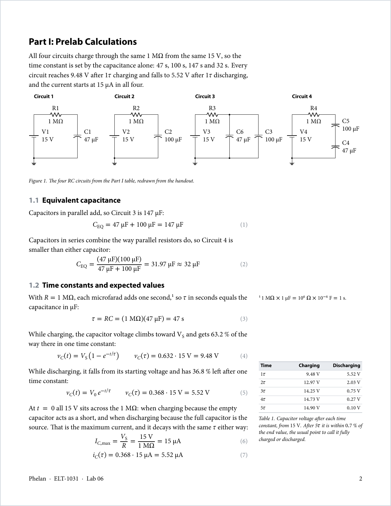
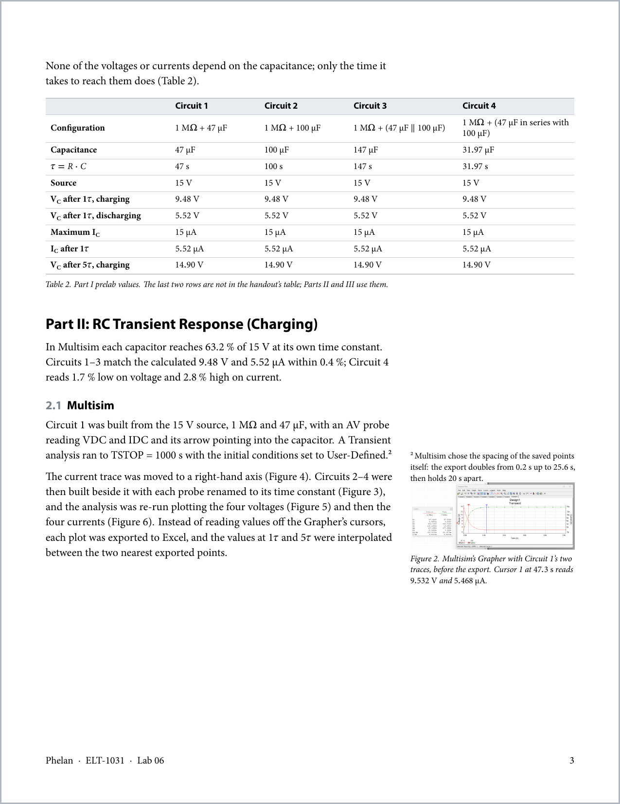
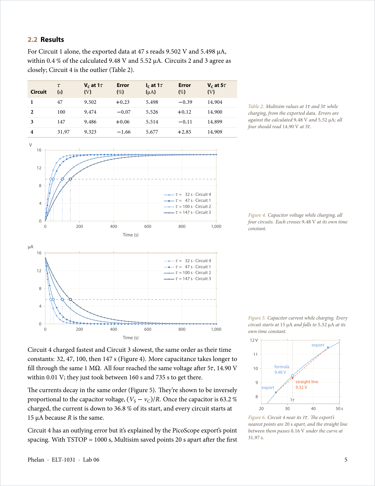
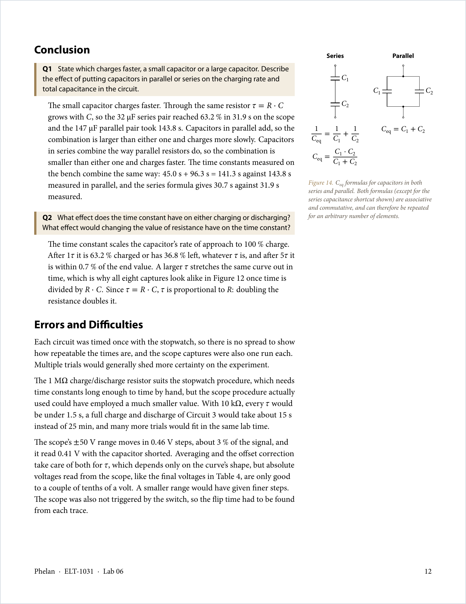

# lennylab

My own LaTeX style for lab reports. The page layout is inspired by the Tufte-style book: a narrow text column with a wide margin beside it for notes, small tables and figures, plus a full cover page and blocks that run across both columns. The type, tables, units and colors are my own house style: Minion Pro for the text and Myriad Pro for the headings.

The sample below is a real report of mine, an RC transient lab. Its source and PDF are in [`showcase/`](showcase/).

## Inside

- `lennylab.cls`: the document class
- `showcase/`: the report above, with its pgfplots and circuitikz sources
- `template/`: a blank report to start from

It builds with LuaLaTeX and needs Minion Pro, Myriad Pro and STIX Two Math installed. The comments at the top of the class list its commands.

The class option `offwhitecover` (`\documentclass[offwhitecover]{lennylab}`) prints the cover on a warm off-white (`labOffWhite`, #FAF7F0) instead of white; the pages after it stay white.

## License

[MIT](LICENSE)
